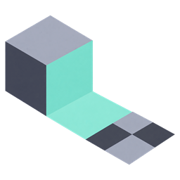
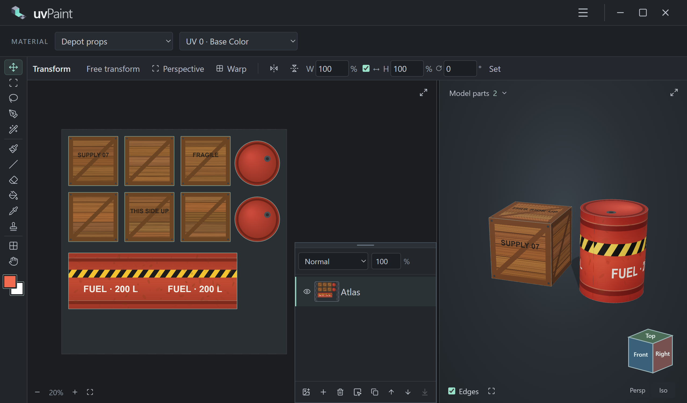
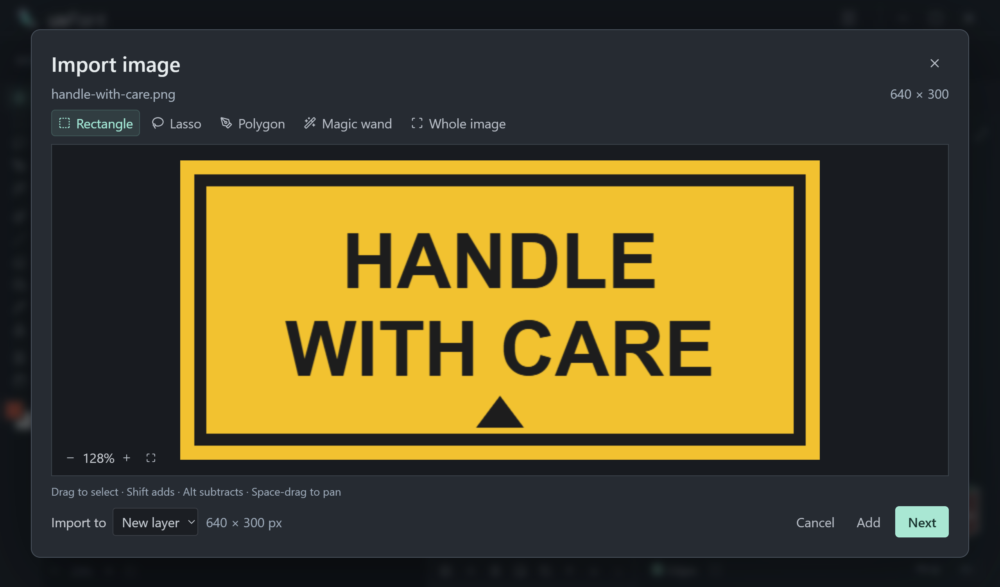
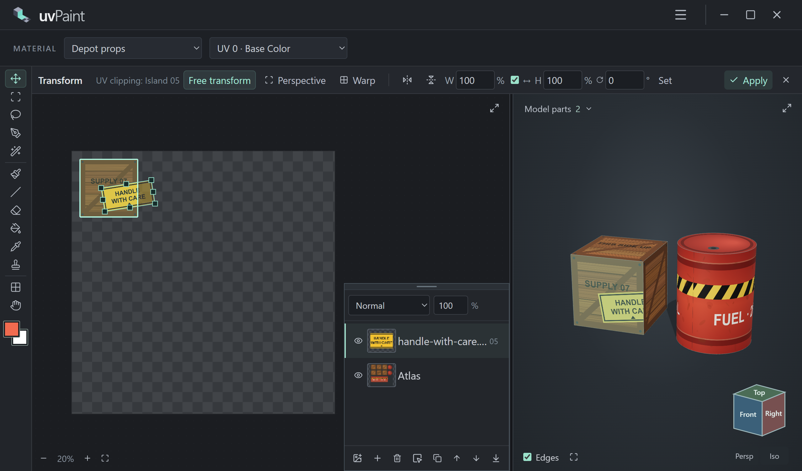
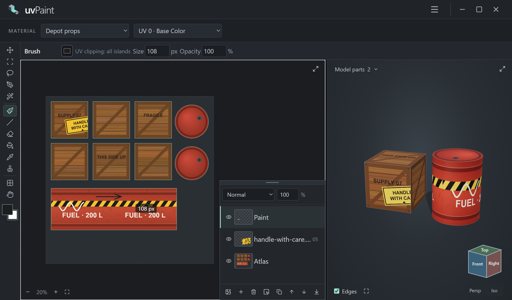
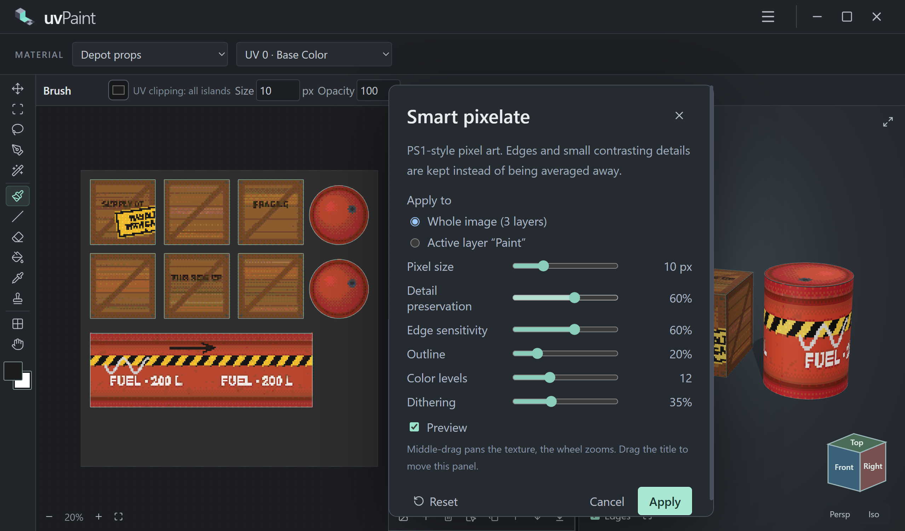

<p align="center">
  
</p>

<h1 align="center">uvPaint</h1>

<p align="center">
  <b>🎨 A texture workbench for 3D models — paint in 2D, see it live in 3D.</b><br />
  UV-aware layers · island-linked decals · smart PS1-style pixelation · offline Windows app
</p>

<p align="center">
  <a href="https://github.com/zufari4/uvPaint/releases/tag/v1.0.2"></a>
  <a href="https://www.npmjs.com/package/uvpaint"></a>
  
  <a href="LICENSE"></a>
</p>



## ✨ Highlights

| | |
| --- | --- |
| 🧊 **Live 3D preview** | Open a GLB and every brush stroke, decal and filter appears on the model instantly. |
| 🗺️ **UV islands everywhere** | Outlines, quads or triangles over the texture; click an island in 2D or 3D to select it and its layer. |
| 🧩 **Island-linked layers** | Bind a layer to an island: pixels outside it are masked (not deleted) and stay visible at 40% while you place them. |
| 🖼️ **Image import** | Cut a region with rectangle, lasso, polygon or magic wand and drop it straight onto a picked island. |
| 🔀 **Transforms** | Free transform, four-corner perspective and a 16-point mesh warp — rendered on the GPU. |
| 🖌️ **Painting tools** | Brush, line, eraser, island fill, clone stamp and eyedropper with Blender-style **F** resizing. |
| 👾 **Smart pixelate** | PS1-style pixel art that keeps edges, thin lines and small details instead of averaging them away. |
| 💾 **Projects** | `.uvpaint` files keep the model, every texture, layer, binding and selection — no external files needed. |
| 📤 **Clean export** | RGBA PNG with automatic island padding: edges grow by half of the smallest gap between islands. |

## 📸 Screenshots

### 🖼️ Import an image and pick the area you need


### 🧩 Place a decal on a linked island
The frame transforms the image; everything outside the island stays faintly visible, so alignment is easy.


### 🖌️ Paint with brush and line tools
Press **F** to resize the brush right under the cursor, exactly like in Blender.


### 👾 Smart pixelate with live preview
Sliders update the 2D texture and the 3D model while you drag them; the whole image or only the active layer.


## 🚀 Getting started

1. ⬇️ Download **[uvPaint-Setup-1.0.2.exe](https://github.com/zufari4/uvPaint/releases/download/v1.0.2/uvPaint-Setup-1.0.2.exe)** from the [Releases](https://github.com/zufari4/uvPaint/releases/tag/v1.0.2) page and run it. The installer is not code-signed yet: if SmartScreen appears, choose **More info → Run anyway**.
2. Start **uvPaint** from the Start menu or the desktop shortcut.
3. Open a GLB (**Ctrl+O**) or try the built-in sample (a supply crate and a fuel drum with two materials, UV atlases and layers linked to UV islands), pick a material and start painting.

No account, Blender or internet connection is required. **Check for updates** in the ☰ menu compares your version with the latest GitHub release. To build it yourself, see [Building from source](#️-building-from-source); the result is `release/current/win-unpacked/uvPaint.exe` (keep the whole folder together).

### 📦 Or install with npm

```powershell
npm install -g uvpaint
uvpaint
```

Requires Node.js 18+; npm downloads the Electron runtime during installation. Update with `npm update -g uvpaint`, remove with `npm uninstall -g uvpaint`.

## ⌨️ Shortcuts

| Action | Keys |
| --- | --- |
| Move / free transform | **V** / **Ctrl+T** |
| Rectangle · lasso · polygon · magic wand | **M** · **L** · **Shift+L** · **W** |
| Brush · line · eraser · fill · eyedropper · clone | **B** · **N** · **E** · **G** · **I** · **S** |
| Resize brush under the cursor | **F**, move, click (**Esc** cancels) |
| Brush size / color alpha | **[** **]** / **1–9**, **0** |
| Straight line | **N**: click two points or drag, drag end points to adjust, **Enter** applies, **Shift** snaps to 45° |
| Shapes | Hold or right-click the line button to pick a rectangle, ellipse or regular polygon; choose fill (primary color) and outline (secondary color) in the options bar, **Shift** draws squares and circles; before **Enter**, drag inside to move the shape and just outside to rotate it (**Shift** / **Ctrl** snap) |
| Gradient | Hold or right-click the fill button (or **Shift+G**) for linear and radial gradients from the primary to the secondary color; drag the end points to adjust, **Enter** applies |
| Select all / deselect / invert | **Ctrl+A** / **Ctrl+D** / **Ctrl+Shift+I** |
| Copy · cut · paste · to new layer · extract | **Ctrl+C** · **Ctrl+X** · **Ctrl+V** · **Ctrl+J** · **Ctrl+Shift+J** |
| Apply / cancel transform | **Enter** / **Esc** |
| Undo / redo | **Ctrl+Z** / **Ctrl+Shift+Z**, **Ctrl+Y** |
| Open GLB · open project · save · save as · export PNG | **Ctrl+O** · **Ctrl+Shift+O** · **Ctrl+S** · **Ctrl+Alt+S** · **Ctrl+Shift+S** |
| Pan / zoom 2D | **Space**-drag, **H** or middle-drag / wheel |
| Orbit / pan / zoom 3D | middle-drag / **Shift**+middle / wheel, numpad views |

Shortcuts use physical keys, so they also work with a Russian keyboard layout.

## 🧭 Workflow tips

- 🎯 **Click an island** with the Move tool to select it, its linked layer (the Layers panel scrolls to it) and open the transform frame. A click on empty space with the Move or UV island tool, **Esc** or the **Show all layers** icon next to the zoom controls shows everything again; painting and selecting beyond the island keep the focus.
- 🔗 **Link a layer** to an island with the picker button in the Layers toolbar; the island number appears in the layer row.
- 🫥 **Hide or isolate islands** from the right-click menu — this only changes the view, never the pixels.
- 🪣 **Fill** on a UV-mapped texture fills the whole island under the cursor.
- 📌 New and pasted layers appear right above the selected layer.
- 🧱 Drag the Layers panel by its top strip to any corner of the texture view, or collapse it to a side tab with the **»** button.
- � Built-in color picker with a hue wheel, value and alpha sliders: paint transparency comes from the color itself; brush and eraser also have a **Hardness** setting for soft edges.
- 🧷 The clone stamp keeps its offset between strokes: after Alt-click the source marker travels with the brush.

## 🛠️ Building from source

Requires Windows, Node.js 22.12+ and npm.

```powershell
npm ci
npm run dev        # Vite + Electron with hot reload
npm run build      # type-check and compile
npm run dist       # build release/current/win-unpacked/uvPaint.exe
npm run pack:npm   # stage the npm package in dist-npm/
npm run dist:installer  # build release/current/uvPaint-Setup-1.0.2.exe
npm test           # unit tests
```

Electron regression suites live in `scripts/` (`npm run test:paint`, `test:filter`, `test:line`, `test:layers-panel`, `test:packaged` and more). `node scripts/screenshots.mjs` regenerates the images above.

### 📁 Project layout

| Folder | Contents |
| --- | --- |
| `electron/` | sandboxed window, native dialogs, validated IPC |
| `src/core/` | documents, history, preferences, projects |
| `src/render/` | compositing, 3D materials, GPU warps |
| `src/tools/` | painting, selection, UV topology, transforms, pixelation |
| `src/import/`, `src/export/` | GLB loading, PNG export with island padding |
| `src/ui/` | React workspace, dialogs and shortcuts |

## 📏 Scope

Standard GLB geometry with embedded images; one 0–1 texture tile per material. Draco/Meshopt, KTX2, UDIM, painting directly on the 3D model and GLB export are not included. Texture size is limited only by the GPU and available memory — images are never silently downscaled.

## 📄 License

[MIT](LICENSE) © 2026 uvPaint contributors
